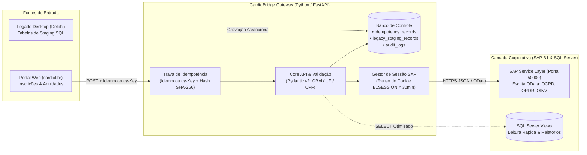

# 🫀 CardioBridge — Enterprise ERP & Legacy Integration Gateway


-0FAAFF?style=flat&logo=sap&logoColor=white)

Prova de Conceito (PoC) arquitetural desenvolvida em **Python (FastAPI)** para demonstrar uma esteira resiliente de integração entre **portais web médicos**, **sistemas legados em Delphi (SQL Server)** e o ERP **SAP Business One (via Service Layer OData)**.

---

## 🎯 1. O Problema de Engenharia Resolvido

Em instituições médicas de grande porte (como a **Sociedade Brasileira de Cardiologia - SBC**), o ecossistema de TI precisa lidar simultaneamente com três desafios críticos:
1. **Picos de Concorrência em Grandes Eventos:** Durante aberturas de inscrições para congressos ou vencimento de anuidades, oscilações de rede levam usuários a clicarem repetidamente no botão de pagamento. Sem proteção de idempotência, isso gera pedidos (`ORDR`) e faturas (`OINV`) duplicados no ERP.
2. **Governança Estrita do SAP Business One:** O SAP B1 proíbe operações de `INSERT` ou `UPDATE` via SQL direto nas tabelas nativas (sob risco de corromper o controle sequencial na tabela `ONNM` e invalidar o suporte oficial). Toda escrita deve ocorrer via **Service Layer (REST/OData)**, enquanto o SQL Server direto é utilizado para leitura otimizada (`Views`).
3. **Convivência com Sistemas Legados (Delphi):** Módulos desktop antigos não podem ser desligados abruptamente. É necessário extrair regras de negócio e sincronizar dados de forma assíncrona aplicando o **Padrão Estrangulador (*Strangler Fig Pattern*)**, sem causar *deadlocks* no banco de dados.

---

## 🏛️ 2. Arquitetura da Solução



---

## 🛡️ 3. Pilares Técnicos Implementados

### A. Idempotência Transacional Anti-Duplicação (`app/core/idempotency.py`)
* Exige o cabeçalho `Idempotency-Key` em operações financeiras e de inscrição (`POST /api/v1/eventos/inscricoes`).
* Calcula o hash **SHA-256** do payload recebido:
  * **1ª Requisição (`MISS-NEW-TRANSACTION`):** Valida os dados, gera a ordem no ERP e persiste o resultado na tabela `idempotency_records` com TTL de 24h.
  * **Requisições Repetidas (`HIT-PREVIOUS-TRANSACTION`):** Intercepta a chamada antes de bater no SAP B1 e devolve instantaneamente o mesmo `DocEntry` já gerado.
  * **Proteção contra Violação de Contrato (`409 Conflict`):** Se a mesma chave for enviada com um payload adulterado (ex: valor diferente), a API bloqueia a requisição.

### B. Governança de Sessão na Service Layer (`B1SESSION`)
* Autenticação no endpoint `/b1s/v1/Login` da Service Layer exige gerenciamento inteligente de estado: fazer login a cada requisição esgota conexões e degrada a performance.
* A arquitetura prevê o **reaproveitamento do cookie `B1SESSION` e `ROUTEID`** em memória/cache durante a janela de validade (padrão de 30 minutos do SAP), realizando *re-login* transparente apenas em caso de expiração (`401 Unauthorized`).

### C. Auditoria Ponta a Ponta e Staging do Legado (`app/models/`)
* **`AuditLog` (`audit_logs`):** Registra método, endpoint, payload enviado, resposta recebida, status HTTP e tempo de execução em milissegundos para rastreabilidade junto à controladoria e fornecedores externos (ex: consultoria SAP).
* **`LegacyStagingRecord` (`legacy_staging_records`):** Tabela desacoplada para o *Strangler Fig Pattern*, controlando o ciclo de vida da migração (`PENDING` $\rightarrow$ `PROCESSING` $\rightarrow$ `SYNCED` / `ERROR`) com contador de retentativas.

---

## 🚀 4. Como Executar Localmente

```bash
# 1. Ativar o ambiente virtual
source .venv/bin/activate

# 2. Subir o servidor FastAPI
uvicorn app.main:app --reload
```

* **Documentação Interativa (Swagger UI):** `http://localhost:8000/docs`
* **Health Check:** `http://localhost:8000/health`

### Exemplo Prático: Testando a Trava de Idempotência
```bash
# Primeira chamada -> Status 201 (Header: X-Cache-Idempotency: MISS-NEW-TRANSACTION)
# Segunda chamada idêntica -> Status 201 (Header: X-Cache-Idempotency: HIT-PREVIOUS-TRANSACTION, mesmo DocEntry)
curl -i -X POST "http://localhost:8000/api/v1/eventos/inscricoes" \
     -H "Content-Type: application/json" \
     -H "Idempotency-Key: cong-sbc-2026-med-123456" \
     -d '{
       "crm": "123456",
       "uf": "RJ",
       "nome_medico": "Dr. Roberto Kalil",
       "codigo_evento": "CONG-CARDIO-2026",
       "valor": 850.00,
       "forma_pagamento": "PIX"
     }'
```
