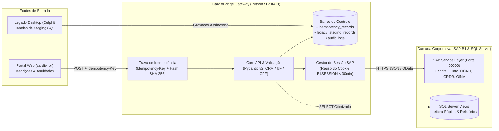

# 🫀 CardioBridge — Enterprise ERP & Legacy Integration Gateway


-0FAAFF?style=flat&logo=sap&logoColor=white)

Prova de Conceito (PoC) arquitetural desenvolvida em **Python (FastAPI)** para demonstrar uma esteira resiliente de integração entre **portais web médicos**, **sistemas legados em Delphi (SQL Server)** e o ERP **SAP Business One (via Service Layer OData)**.

---

## 🎯 1. O Problema de Engenharia Resolvido

Em instituições médicas de grande porte (como a **Sociedade Brasileira de Cardiologia - SBC**), o ecossistema de TI precisa lidar simultaneamente com três desafios críticos:
1. **Picos de Concorrência em Grandes Eventos:** Durante aberturas de inscrições para congressos ou vencimento de anuidades, oscilações de rede levam usuários a clicarem repetidamente no botão de pagamento. Sem proteção de idempotência, isso gera pedidos (`ORDR`) e faturas (`OINV`) duplicados no ERP.
2. **Governança Estrita do SAP Business One:** O SAP B1 proíbe operações de `INSERT` ou `UPDATE` via SQL direto nas tabelas nativas (sob risco de corromper o controle sequencial na tabela `ONNM` e invalidar o suporte oficial). Toda escrita deve ocorrer via **Service Layer (REST/OData)**, enquanto o SQL Server direto é utilizado para leitura otimizada (`Views`).
3. **Convivência com Sistemas Legados (Delphi):** Módulos desktop antigos não podem ser desligados abruptamente. É necessário extrair regras de negócio e sincronizar dados de forma assíncrona aplicando o **Padrão Estrangulador (*Strangler Fig Pattern*)**, sem causar *deadlocks* no banco de dados.

---

## 🏛️ 2. Arquitetura da Solução



---

## 🛡️ 3. Pilares Técnicos Implementados

### A. Idempotência Transacional Anti-Duplicação (`app/core/idempotency.py`)
* Exige o cabeçalho `Idempotency-Key` em operações financeiras e de inscrição (`POST /api/v1/eventos/inscricoes`).
* Calcula o hash **SHA-256** do payload recebido:
  * **1ª Requisição (`MISS-NEW-TRANSACTION`):** Valida os dados, gera a ordem no ERP e persiste o resultado na tabela `idempotency_records` com TTL de 24h.
  * **Requisições Repetidas (`HIT-PREVIOUS-TRANSACTION`):** Intercepta a chamada antes de bater no SAP B1 e devolve instantaneamente o mesmo `DocEntry` já gerado.
  * **Proteção contra Violação de Contrato (`409 Conflict`):** Se a mesma chave for enviada com um payload adulterado (ex: valor diferente), a API bloqueia a requisição.

### B. Governança de Sessão na Service Layer (`app/services/sap_client.py`)
* Autenticação no endpoint `/b1s/v1/Login` da Service Layer exige gerenciamento inteligente de estado: fazer login a cada requisição esgota conexões e degrada a performance.
* A arquitetura realiza o **reaproveitamento do cookie `B1SESSION` e `ROUTEID`** em memória durante a janela de validade (padrão de 30 minutos do SAP), executando *re-login* transparente em caso de expiração (`401 Unauthorized`).

### C. Auditoria Ponta a Ponta e Worker do Legado (`app/workers/strangler_worker.py`)
* **`AuditLog` (`audit_logs`):** Registra método, endpoint, payload enviado, resposta recebida, status HTTP e tempo de execução em milissegundos para rastreabilidade junto à controladoria e fornecedores externos.
* **`LegacyStagingRecord` (`legacy_staging_records`):** Tabela desacoplada para o *Strangler Fig Pattern*, controlando o ciclo de vida da migração (`PENDING` → `PROCESSING` → `SYNCED` / `ERROR`) com rollback transacional e contador de retentativas.

---

## 📂 4. Estrutura do Repositório

```text
cardio-bridge/
├── app/
│   ├── api/v1/endpoints/      # Rotas REST (/associados/sync, /eventos/inscricoes)
│   ├── core/
│   │   ├── idempotency.py     # Hash SHA-256 + Proteção 409 Conflict e Cache Hit
│   │   └── database.py        # Sessão SQLAlchemy 2.0
│   ├── models/                # Tabelas: idempotency_records, legacy_staging_records, audit_logs
│   ├── schemas/               # Contratos Pydantic v2 (Validação estrita de CRM/UF/CPF)
│   ├── services/
│   │   └── sap_client.py      # Cliente HTTPX SAP Service Layer (B1SESSION + Retry 401)
│   └── workers/
│       └── strangler_worker.py# Worker de sincronização Legado Delphi -> SAP B1
├── mock_sap/
│   └── mock_server.py         # Emulador da SAP B1 Service Layer (/b1s/v1/Login, OCRD, ORDR)
├── demo_entrevista.py         # Script de 1 comando demonstrando os 3 cenários ponta a ponta
└── tests/                     # Testes automatizados (Pytest)
```

---

## 🚀 5. Como Executar a Demonstração Ponta a Ponta (1 Comando)

```bash
#Ativar o ambiente virtual e rodar a simulação completa (Idempotência + SAP B1 + Worker Delphi):
./.venv/bin/python demo_entrevista.py
```

Ou para subir os servidores separadamente:
```bash
# Terminal 1: Mock SAP Business One Service Layer (Porta 50001)
./.venv/bin/uvicorn mock_sap.mock_server:mock_sap_app --port 50001

# Terminal 2: Gateway CardioBridge FastAPI (Porta 8000)
./.venv/bin/uvicorn app.main:app --reload --port 8000
```
* **Documentação Interativa (Swagger UI):** `http://localhost:8000/docs`
* **Health Check:** `http://localhost:8000/health`

---

## 🗺️ 6. Roadmap de Evolução (Próximas Sprints para Escala Enterprise)

Esta PoC foi desenhada com foco em pragmatismo e execução imediata (*Zero-Setup*). Para evolução em ambiente produtivo de missão crítica e alta concorrência (ex: abertura de lotes de inscrição do Congresso da SBC ou pico de vencimento de anuidades), o planejamento arquitetural prevê 4 sprints evolutivas:

* **Sprint 1 — Cache Distribuído In-Memory (Redis):** Migrar o armazenamento das chaves de idempotência (`TTL 24h`) e do cookie `B1SESSION` do SAP para o **Redis**. Isso elimina consultas ao banco relacional a cada requisição HTTP e permite que múltiplas réplicas do Gateway compartilhem a mesma sessão do ERP em microssegundos.
* **Sprint 2 — Mensageria Assíncrona e DLQ (RabbitMQ):** Substituir o *polling* na tabela `legacy_staging_records` por filas de eventos no **RabbitMQ** com *Dead Letter Queue (DLQ)* e *Exponential Backoff*, eliminando concorrência de leitura/escrita e riscos de lock escalation no SQL Server.
* **Sprint 3 — Escalabilidade Horizontal do Worker (*Competing Consumers*):** Evoluir o worker do padrão Strangler para rodar múltiplas instâncias em paralelo consumindo eventos com travas distribuídas (ou `SELECT ... WITH (UPDLOCK, READPAST)` no SQL Server).
* **Sprint 4 — Observabilidade e Telemetria (OpenTelemetry):** Desacoplar os registros de `audit_logs` do banco relacional para uma stack dedicada (**Prometheus + Grafana + Loki/Elasticsearch**), permitindo métricas de latência em tempo real da Service Layer do SAP e evitando crescimento descontrolado do banco transacional.


